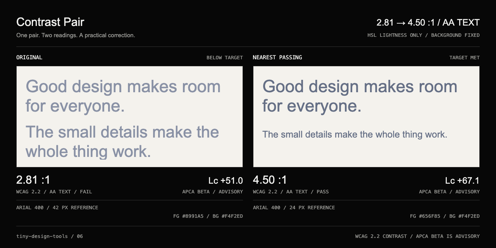

# Contrast Pair

Two colours. One readable pair.

| ① Input | ② Manipulate | ③ Proof |
|---|---|---|
| Paste two hex colours, use the colour pickers, or sample a local image | Move text lightness, compare the nearest passing colour, or swap the pair | Copy the passing CSS, share the pair link, or export a 1280 × 640 PNG |

The demo starts with `#8991A5` text on `#F4F2ED`: 2.81:1. Its nearest AA-normal-text correction is `#656F85`, which exceeds 4.5:1. Both pairs appear side by side using the actual input colours.

## Use

Open `/contrast-pair/`. Set **Text colour** and **Background colour** to opaque `#RGB` or `#RRGGBB` values. Choose AA normal text (4.5:1), AA large text (3:1), or AAA normal text (7:1). **USE PASSING COLOUR** applies the suggested text colour. **COPY CSS** copies the corrected pair; **COPY LINK** shares the current input pair and target. Neither action uploads anything.

Open, drop, or paste a PNG, JPEG, or WebP to sample pixels into either colour. Click the image, or focus it and move the crosshair with arrow keys, then press Enter. Shift moves ten pixels. Transparent image pixels are composited onto white. Sampling is based on browser-decoded pixels, downscaled to a maximum 1200 px on the longest edge. Input is limited to 25 MB and 40 megapixels.

## Measurements and limits

- WCAG 2.2 ratios use the sRGB relative-luminance formula and full precision for pass/fail. Displayed ratios are truncated to two decimals so a near miss cannot appear to pass. Large text means at least 24 px regular or 18.67 px bold.
- The correction searches both darker and lighter foreground lightness with HSL hue and saturation fixed, then chooses the smaller lightness change. It checks the actual 8-bit hex result. Quantization can shift hue/saturation slightly. An already passing pair is unchanged.
- Some backgrounds cannot reach 7:1 with any text colour. The tool explicitly reports no solution rather than claiming a passing pair.
- APCA Lc comes from the unmodified `apca-w3` 0.1.9 algorithm (0.0.98G-4g). Its sign is preserved. It is beta advisory information, separate from WCAG 2.2 pass/fail. No WCAG 3 or APCA certification is claimed.
- The Arial 400 reference specimen follows the upstream reference sizes: 14 px at |Lc| ≥ 90, 16 px at ≥ 75, 24 px at ≥ 60, and 42 px at ≥ 45. Lower readings show explicit non-content/non-text or insufficient-contrast warnings. This is a check for opaque web text colours, not an audit of text on photographs, gradients, or transparent layers.
- The link stores only colours and target in its fragment. Uploaded images and custom specimen text are not included. No account, storage, analytics, backend, or network request is used to manipulate the pair.

## Sources and licensing

- [WCAG 2.2 Contrast (Minimum)](https://www.w3.org/WAI/WCAG22/Understanding/contrast-minimum.html) and [Contrast (Enhanced)](https://www.w3.org/WAI/WCAG22/Understanding/contrast-enhanced.html).
- [Why APCA](https://git.apcacontrast.com/documentation/WhyAPCA), [integration guidance](https://git.apcacontrast.com/documentation/minimum_compliance.html), and [APCA questions and feedback](https://github.com/Myndex/SAPC-APCA/discussions).
- Original tool code is MIT. APCA is © Andrew Somers / Myndex and is distributed under its [Limited W3 License](../../public/licenses/apca-w3-LICENSE.txt) for web-content contrast. The transitive `colorparsley` package carries [AGPL v3](../../public/licenses/colorparsley-LICENSE.txt); its parser is unused and removed from the production application by tree shaking. Neither dependency is relicensed as MIT.

## Verification

`pnpm check` runs math, APCA integration, settings, and existing collection tests, then typechecks and builds. `pnpm capture:contrast-pair` tests actual browser correction, unrounded threshold behaviour, invalid hex, no-solution states, signed Lc, colour sampling, keyboard interactions, clipboard, links, reset, narrow layout, absence of external requests, and the downloaded PNG. It also creates the release capture. The scoped build is tracked in [issue #10](https://github.com/MathieuHJ/tiny-design-tools/issues/10).

Possible next step: sample at native image resolution with a zoomable loupe.
