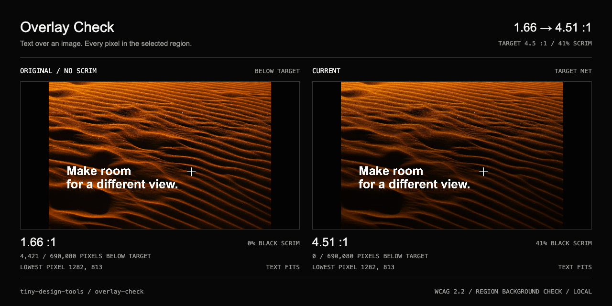

# Overlay Check

Readable text over real photographs.

| ① Input | ② Manipulate | ③ Proof |
|---|---|---|
| A local photograph and your actual text | Move and resize the text box, then apply the minimum passing scrim | CSS gradient, full-size image, or a 1280 × 640 PNG comparison |

The built-in dune photograph has a worst contrast of 1.66:1 in the default text region. A 41% black scrim lifts every checked pixel to at least 4.51:1. The checker uses the whole rectangle rather than an average, so it catches bright patches between the letters too.

## Use

Open `/overlay-check/`. The credited demo starts immediately. Open, drop, or paste a PNG, JPEG, or WebP to use your own image. Edit the text, then drag the box or its corner to move or resize it. Both controls work with arrow keys; Shift moves five percent. Exact box coordinates are available under **TEXT REGION & HOW TO USE THE CSS**.

Choose white or black text, a bottom/top/uniform scrim, and an AA normal (4.5:1), AA large (3:1), or AAA normal (7:1) target. **USE MINIMUM** applies the minimum whole-percent strength under the conservative analysis. The worst contrast and failing pixel count update locally. Switch between **ORIGINAL** and **WITH SCRIM** to compare.

**COPY CSS** becomes available when the current region passes. It includes the full gradient, image aspect ratio, text box coordinates, colour, and relative typography. Use the markup shown in the tool. **SAVE IMAGE** flattens the current text and scrim at the original image resolution. **EXPORT PROOF PNG** exports the real original/current comparison, including the worst pixel, ratio, and failing count. Image/proof exports can document a failure, but empty or clipped text must be corrected before exporting.

## What is checked

- Every decoded source pixel cell intersecting the entire text box; there is no spatial downsampling in the analysis. A Web Worker handles the scan without blocking controls.
- Source transparency is composited onto white. The image is then composited with an opposite-colour black or white scrim in sRGB before computing WCAG 2.2 relative luminance.
- The check conservatively rounds background bytes toward lower contrast: up under white text and down under black. It uses full-precision ratios for pass/fail. Displayed ratios are truncated, so a near miss cannot round up to a passing-looking value.
- The scrim has a flat protected region behind the complete box and fades outside it. Its stops extend to source-pixel boundaries, including fractional edge cells. The canvas renderer and CSS generator share those stops.
- The suggested strength is the first passing integer percentage in this conservative model. Small rounding differences may let an actual renderer pass a fraction sooner. The tool deliberately does not use that rounding advantage.

## Scope and limitations

This checks opaque white or black text on a fixed photo, text region, and aspect ratio. It is not a complete accessibility audit. Recheck after cropping, changing the image, repositioning, or changing responsive layout. The exported relative font size must meet the target's actual text-size requirement when shipped: AA large requires 24 CSS px regular or 18.67 CSS px bold.

Images are limited to 25 MB, 12 megapixels, and 12,000 px per edge to keep exact local processing practical. Larger images are rejected rather than silently reduced. The on-screen preview is reduced to at most 1500 px; analysis and image export retain every source pixel. Proof images contain the full image without cropping, so unusual aspect ratios are letterboxed.

Nothing is uploaded or persisted. There are no accounts, remote fonts, analytics, backend, or processing API. New files replace the previous image; reset returns to the demo.

## Sources and credits

The original tool code is MIT. The demo uses the existing [Edwin Rodriguez dune photograph](https://unsplash.com/photos/DS6lRtglcOM), under its original Unsplash licence; see [credits](../../CREDITS.md). It is not re-licensed as MIT.

The calculation follows [WCAG 2.2 Contrast (Minimum)](https://www.w3.org/WAI/WCAG22/Understanding/contrast-minimum.html) and [sRGB alpha compositing](https://www.w3.org/TR/css-color-4/#simple-alpha-compositing). The tool reports WCAG 2.2 contrast only; it adds no new APCA dependency.

## Verify

`pnpm check` runs the collection test suite, lint, typecheck, and production build. `pnpm capture:overlay-check` drives the real browser workflow, exports the proof and original-resolution image, tests an isolated bright pixel, inspects actual rendered CSS, and verifies pointer/keyboard placement, clipping, targets, invalid files, reset, mobile layout, clipboard, and local-only processing. It also generates release screenshots and a short capture. The build is tracked in [issue #12](https://github.com/MathieuHJ/tiny-design-tools/issues/12).

Possible next step: crop presets with an explicit recheck per crop.
